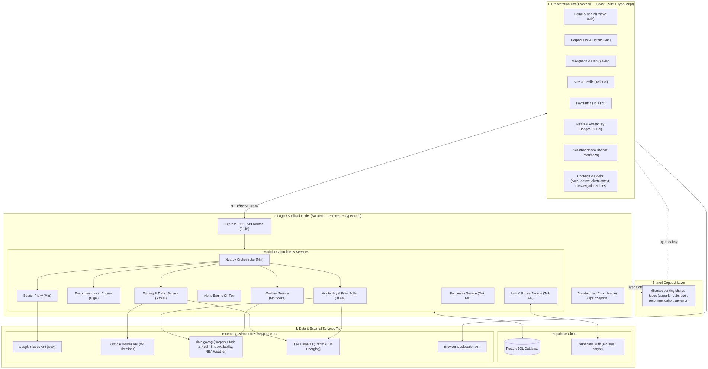
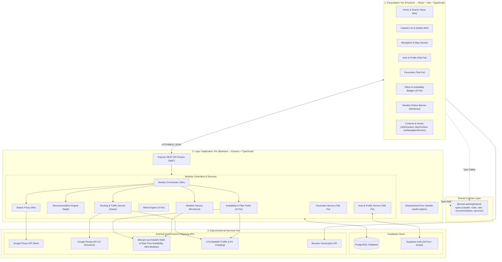

# System Architecture Document

**Project:** Smart Parking Recommendation App (SC2006 Team 1)  
**Date:** October 2026  
**Document Version:** 1.0  

---

## 1. Executive Summary

This document describes the high-level system architecture of the **Smart Parking Recommendation App**, structured according to the software engineering standards of **NTU SC2006**. It details the **3-Tier Client-Server Architecture** (physical/deployment layers) and the **Boundary-Control-Entity (BCE)** design pattern (logical object-oriented design).

---

## 2. High-Level 3-Tier Architecture

The system is organized into three distinct tiers:

### 2.1. Presentation Tier (`apps/frontend`)
* **Technology:** React 18, Vite, TypeScript, CSS Modules.
* **Layout Baseline:** Mobile portrait viewport standard (360×780px baseline, responsive up to 380×760px device frame).
* **Key Components:**
  * `SignInPage` & `SignUpPage` (Teik Fei)
  * `SearchPage` with live debounced Google Places autocomplete (Min)
  * `CarparkListPage` & `CarparkDetailsPage` with real-time lot progress bars & filter chips (Min, Xi Fei)
  * `NavigationPage` supporting multi-pin \(A \rightarrow P \rightarrow B\) multi-modal route guidance, polyline rendering, and weather notice banners (Xavier, Moufooza)
  * `FavouritesPage` with quick navigation, rename, and undo deletion (Teik Fei)
  * `ProfilePage` for vehicle preference configuration (Teik Fei)

### 2.2. Logic / Application Tier (`apps/backend`)
* **Technology:** Node.js, Express, TypeScript.
* **Nearby Carpark Orchestrator (`GET /api/carparks/nearby`):** Central coordination endpoint owned by Min that combines:
  1. **Candidate Carparks:** Proximity query from the static catalog.
  2. **Filtering:** Applied via Xi Fei's filter module (EV only, max cost, covered/multi-storey).
  3. **Real-Time Availability:** Fetched from the 1-minute cached table.
  4. **Traffic-Aware ETA:** Computed by Xavier's routing service via Google Routes API.
  5. **Recommendation Scoring:** Nigel's scoring engine evaluating the mathematical formulas:
     \[
     w = 0.5^{(\text{ETA} / 15)}
     \]
     \[
     \text{AvailabilityScore} = w \cdot \text{RealTimeRatio} + (1 - w) \cdot \text{HistoricalRatio}
     \]
     \[
     \text{BaseScore} = 0.6 \cdot \text{AvailabilityScore} + 0.4 \cdot \text{WalkingScore}
     \]
     *(with rain adjustment preference for sheltered carparks).*
* **Error Resilience:** Centralized error handling via `ApiException` returning standard `ApiError` structures, with partial degradation support (`degradedServices` array).

### 2.3. Data & Persistence Tier
* **Database (Supabase / PostgreSQL):**
  * `profiles`: User information and vehicle types.
  * `favourite_locations`: Saved destinations per user.
  * `carparks`: Master static catalog of Singapore carparks merged with LTA EV charging stations.
  * `carpark_availability_historical`: Pre-aggregated hourly time buckets from historical data.
  * `carpark_availability_cache`: Refreshed every 60 seconds by a background poller.
  * `alerts`: Monitored carparks for significant lot changes.
* **External Third-Party APIs:**
  * **Google Maps Platform:** Places API (New) & Routes API (v2).
  * **data.gov.sg:** Carpark Info, Real-time Carpark Availability, 2-Hour Weather Nowcast, 5-Minute Rain Area.
  * **LTA DataMall:** Traffic speed bands and EV charging locations.

---

## 3. Boundary-Control-Entity (BCE) Mapping (SC2006 OOAD)

In accordance with Jacobson's Object-Oriented Software Engineering (OOSE) methodology required in SC2006:

| Category | Component Description | Specific Project Artifacts |
|---|---|---|
| **Boundary (B)** | UI interfaces and external API gateways | `HomePage`, `SearchPage`, `CarparkListPage`, `CarparkDetailsPage`, `NavigationPage`, `FavouritesPage`, `ProfilePage`, `SignInPage`, `SignUpPage`, REST API routes (`/api/*`), `GooglePlacesClient`, `GoogleRoutesClient`, `DataGovClient`, `LTADataMallClient` |
| **Control (C)** | Use case coordinators, algorithmic logic, and workflows | `NearbyCarparksOrchestrator`, `RecommendationEngine`, `RoutingService`, `AvailabilityPoller`, `FilterControl`, `AlertService`, `AuthService`, `FavouritesService` |
| **Entity (E)** | Passive domain data models and state containers | `User` / `Profile`, `Carpark`, `CarparkAvailability`, `HistoricalAvailabilityRecord`, `FavouriteLocation`, `AvailabilityAlert`, `Route` / `NavigationLeg`, `WeatherForecast` |
