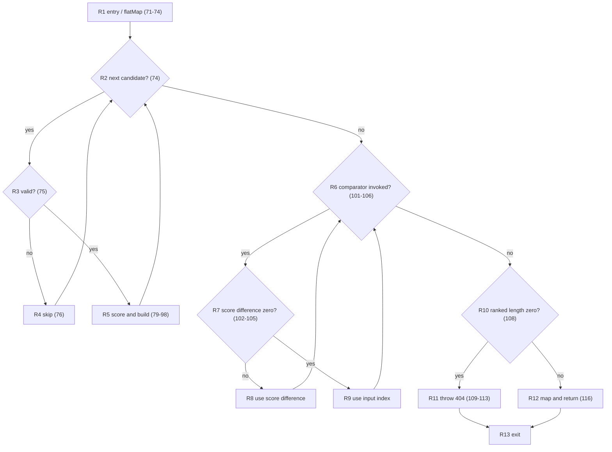
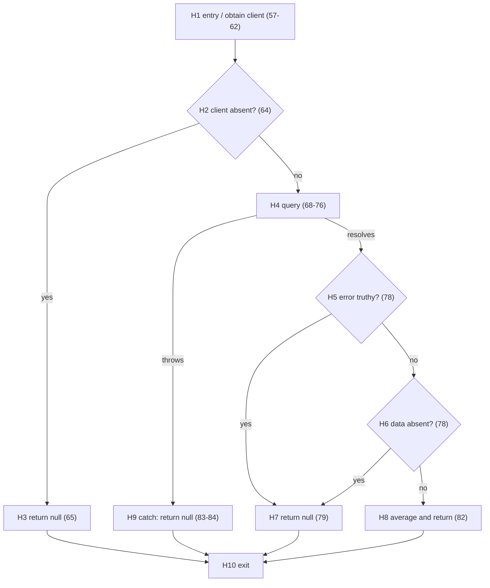

# Lab 4 white-box testing

[`getNearbyCarparks()`](../apps/backend/src/modules/search/search.service.ts) was inspected. Its weather, database, availability, filtering, walking/driving routing, history, scoring, and sorting branches make a compact method-level CFG difficult to audit. The selected methods are `rankCarparks()` (candidate validation/scoring and stable ordering) and `getHistoricalAvailabilityRatio()` (client/query failure handling and historical aggregation). These implement substantial recommendation logic, with external access mocked only at the database boundary.

## Method 1: `rankCarparks()`

Source: [`rank-carparks.ts`](../apps/backend/src/modules/recommendation/rank-carparks.ts). CFG abstracts `hasValidScoringData()` and `calculateRecommendationScore()` as calls; their internal decisions are outside this method. The sort comparator's `||` is split at R7. R6 represents zero or more comparator invocations; array iteration is R2. Exception edges from unanticipated scorer exceptions are outside the specified input contract.

N=13, E=17, so V(G)=17−13+2=6. Five binary decisions (R2, R3, R6, R7, R10) give 6. The sort comparison is represented as an iteration even though JavaScript's sort chooses invocation count; tests assert output rather than a specific comparison schedule.

| Path | Nodes (repeated nodes abbreviated) | Distinguishing input / expected result | Existing test |
|---|---|---|---|
| WB-R1 | R1 R2(no) R6(no) R10(yes) R11 R13 | empty list → 404 `NO_CARPARKS_FOUND` | “empty input” |
| WB-R2 | R1 R2 R3(yes) R5 R2(no) R6(no) R10(no) R12 R13 | one scoreable carpark → one ranked result | “scorer fallback” |
| WB-R3 | R1 R2 R3(no) R4 R2(no) R6(no) R10(yes) R11 R13 | only unscoreable candidates → 404 | “all candidates are unscoreable” |
| WB-R4 | R1 R2 R3(yes) R5 … R6(yes) R7(no) R8 R6(no) R10(no) R12 R13 | unequal scores → descending scores | “descending recommendation score” |
| WB-R5 | R1 R2 R3(yes) R5 … R6(yes) R7(yes) R9 R6(no) R10(no) R12 R13 | equal scores → input order | “preserves input order” |
| WB-R6 | R1 R2 R3(no) R4 R2 R3(yes) R5 R2(no) R6(no) R10(no) R12 R13 | invalid then valid → valid retained | “mixed list” |

Each path adds a distinct edge or cycle. These six feasible path families are exercised by existing tests; additional malformed-input tests cover validation within the helper, not extra method-level basis paths. No new rank tests were needed.

## Method 2: `getHistoricalAvailabilityRatio()`

Source: [`historical-availability.ts`](../apps/backend/src/modules/recommendation/historical-availability.ts). CFG treats `averageHistoricalRatios()` as a called helper; existing tests additionally exercise its valid-row filtering and four-distinct-date rule. `error || !data` is split into H5/H6 because of short circuiting. The rejected promise/throw enters H9.

N=10, E=13, so V(G)=13−10+2=5. Four decisions/branch points (H2, H4 exception, H5, H6) give 5. The `try` block's exception edge is counted; errors inside the averaging helper also follow H9.

| Path | Nodes | Input / expected result | Test |
|---|---|---|---|
| WB-H1 | H1 H2(yes) H3 H10 | no client → null | existing “client is unavailable” |
| WB-H2 | H1 H2(no) H4(resolve) H5(no) H6(no) H8 H10 | four valid dates, ratios .5/.5/.25/.75 plus 1.2 → .64 | existing “averages all valid” |
| WB-H3 | H1 H2(no) H4(resolve) H5(yes) H7 H10 | query error → null | existing “query fails” |
| WB-H4 | H1 H2(no) H4(resolve) H5(no) H6(yes) H7 H10 | data null without error → null | new “succeeds without data” |
| WB-H5 | H1 H2(no) H4(throws) H9 H10 | query throws → null | new “query throws” |

The five method-level paths are feasible and covered. Two further existing tests cover the helper's insufficient-history and invalid-row cases. This is basis-path coverage for the documented CFG, not a measured statement/branch coverage percentage.
